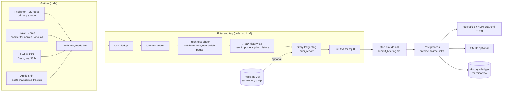

# competitive-briefing

A daily competitive-intelligence briefing that replaces about half an hour of manual feed-reading with a five-minute read. Code gathers, filters and de-duplicates the day's news; one structured call to Claude writes the briefing; code checks the result and delivers it.

I built the original for my own daily work as a product manager on a legal-AI product, and ran it every morning for months. This repository is a cleaned-up extraction of that pipeline. The example configuration tracks **AI coding assistants** instead, so it can be read and run without any of the original context.

[Sample output](examples/sample-briefing.md) (synthetic: every company and event in it is invented).

---

## The problem

Keeping up with a fast-moving competitive market meant reading a dozen trade-press feeds, a few subreddits and whatever search turned up, every morning, and still missing things. The cost wasn't only the 30 minutes. It was that the reading was shallow: most of it was the same story told by a different outlet, or last week's story re-surfacing, and the useful part (what changed, and what it means for my product) was the part I had the least time for.

What I wanted from a briefing:

- **Only what's new.** A story I've already been told about is noise, unless something material changed. A correction or retraction always counts.
- **Why it matters to my product,** in a line, for every item where it does.
- **A source on every item,** so I can check anything that looks surprising.
- **Nothing I have to babysit.** I'm not going to audit what the system chose to leave out, so it should err on the side of letting things through.

## Who it's for

A product manager, founder or analyst who owns a product in a crowded market and needs to know each morning what competitors shipped, how practitioners reacted, and what changed in regulation, without becoming a full-time news reader. It also works for a small team: each *edition* is a different reader, region or language built from the same tuned prompt.

## How it works



It is a **prompt chain with a single model call**, not an agent. Code fixes the whole sequence; the model gets one request, one tool to submit structured output through, and no say in what happens before or after. That keeps the cost per run predictable, makes every step testable without a model, and means a bad day from one source can't send the model off exploring.

| Stage | Module | What it does |
|---|---|---|
| Gather | `feeds.py`, `search.py`, `reddit.py` | RSS/Atom feeds (with per-feed health tracking, optional per-feed User-Agent, and detection of bot-wall HTML served with a 200), rate-limited Brave queries, Reddit's open RSS feeds plus the Arctic Shift archive for engagement |
| Filter | `filters.py`, `search.py` | URL and headline-similarity dedup; fetch each article once to verify its date against the publisher's own metadata and drop home/section pages |
| Tag | `filters.py`, `story_ledger.py` | Mark repeats against the last 7 days and against a permanent ledger of every story ever sent, as hints for the editor. Nothing is dropped here |
| Compose | `editorial.py` | One streamed Messages API call with a strict `submit_briefing` tool; results wrapped as untrusted data |
| Post-process | `editorial.py`, `render.py`, `delivery.py` | Inject any missing source links from the structured output; write HTML and Markdown; email if configured; record what was sent |

## Key decisions, and the evidence behind them

### Feeds first, search second

The first version used web search alone. Over a seven-day sample, **only 2 of 33 trade-press articles** that should have reached the briefing did so via search, while one-off low-tier sites filled the gaps. Publisher feeds are free, carry the publisher's own date and name the outlet. Search stays, but for what it's good at: competitor names and the long tail. Feed results go first in the combined list so URL dedup keeps the feed copy.

Two aggregator feeds were tried for competitor coverage and rejected the same day: one returned nothing useful, the other returned encoded redirect links that don't resolve to the article.

### Trust the publisher's date, not the search engine's

A search engine dated a year-old article as yesterday's, because it had re-crawled the page, and it went out as news. So every non-social result is now fetched once and its publisher date (`article:published_time`, JSON-LD `datePublished` and similar) replaces the search date; anything older than 48 hours is dropped. Pages with no publisher date are kept on the search date, because that's all there is.

Section and home pages always look fresh whatever story they carry, so they're dropped too. Two obvious heuristics turned out to be unreliable on their own:

- **URL depth.** A one-segment path is often a real article (`site.com/vendor-ships-new-agent`).
- **`og:type`.** Some publishers mark every article `website`.

What works is the combination: JSON-LD `CollectionPage`, or `og:type=website` *and* a last path segment that is a plain word (`/technology`, `/ai`).

### A permanent story ledger, because 7 days of history isn't memory

The first de-duplication was a 7-day history of what had been sent. That's a recency signal, not memory: one vendor's model launch was re-reported across **17 briefings in six weeks**, because each new outlet arrived with a fresh URL and fresh wording.

The ledger keys stories rather than articles: a normalised **entity set plus an event class** (`vendor+model|launch`), built from the headline only. (Using the summary too was tried and removed: summaries name incidental parties, and one funding story keyed on an investor became an attractor for a dozen unrelated stories.)

Within a bucket, a text-overlap threshold decides whether two mentions are the same story. A flat threshold provably can't work. Replayed over the full archive of about 2,500 story mentions:

| Flat threshold | Stories | Matches | Catches the reported repeat? |
|---|---|---|---|
| 0.20 | 1,364 | 863 | yes, but its weakest matches are plainly wrong |
| 0.22 | 1,551 | 648 | yes |
| 0.25 | 1,764 | 402 | no |
| 0.28 | 1,893 | 269 | no |

The real repeat scored 0.23. The junk that a 0.20 threshold admits lives in *generic* buckets (no entities or one), while the repeat lived in a two-entity bucket, specific enough that two different stories landing there is unlikely. So the bar depends on the bucket: **0.20 for two or more entities, 0.30 otherwise**. That separates the two cases instead of trading one against the other.

**Precision over recall, by explicit choice.** The user requirement was: *"it's better for duplicates to occasionally get through… I have zero interest in having to manually check what got blocked."* So an uncertain match lets the story through, and **nothing is hard-dropped**: a match adds a small `prior_report` field (when it was first sent, how many times, what was said) and the editor decides. A looser "same entities, any event" tier was built and removed for the same reason: 237 matches at a median similarity of 0.11, mostly junk, and no floor separated them from the real long-range catches.

### A small judgement model beats word overlap for "same story?"

Word overlap only *finds* candidates. Whether a candidate is the same event is judged by [TypeSafe Jev](https://docs.typesafe.ai), a model that returns typed probabilities rather than text. Compared over the archive, the overlap gate **wrongly flagged about 60 of its 225 matches** (mostly unrelated forum threads sharing vocabulary) and **missed about 190 real repeats**. Hand-checked samples: Jev was right on roughly 23 of 25 of the overlap matches it rejected and 22 of 25 of its extra catches.

Two details mattered:

- **One request per (result, candidate) pair, not one per result.** Accuracy drops as the state fills with irrelevant prior stories.
- **Cap the candidates.** The first live test, uncapped, sent **1.8M tokens for 14 results**, because generic buckets hold hundreds of variants. Capped at 5 by entity, 5 by exact key and 3 by text, a run is about 150 pairs, roughly **$0.004–0.008**.

Jev is optional. Without `TYPESAFE_API_KEY` the ledger logs that it is using the word-overlap fallback, which is also what it falls back to per result on any Jev error.

### Structured output, and the order of its fields

The briefing used to come back as free-text JSON. One morning it failed to parse; the fallback kept the HTML but returned an empty list of reported items, so nothing was recorded, and **the next morning re-reported the same stories as new**. The model now submits through a `submit_briefing` tool, and the code refuses a result without a proper `reported_items` array rather than quietly continuing.

Field order matters too. The schema is generated in order, and when `reported_items` came after about 50,000 characters of HTML the model once emitted it as a *stringified* array. Short structured fields now come first (`repeat_check`, then `reported_items`), the long `briefing_html` last. `repeat_check` also makes the model write down, item by item, which earlier report a story repeats and what is new, *before* it writes the prose.

On current models a forced `tool_choice` is rejected, so the call uses `auto` with `strict: true` on the tool (the API validates the input against the schema) and a prompt instruction; if no tool call comes back, the code appends one follow-up message and asks again.

### Enforce what matters in code, not only in the prompt

The prompt asks for a linked source on every item. One day the model dropped every link while still returning the URLs in `reported_items`. `ensure_source_links()` now injects a source line for any item without one, matched by headline overlap. Prompts carry intent; code carries guarantees.

### Strict rules on repeats and on time

Repeats were the most common complaint, so the prompt's default for anything already sent is *omit*. It gets back in only with a specific new fact — a correction, a reversal, an outcome, new numbers, a new party — and is then anchored to the earlier report ("Correcting Friday's report: …"). A timeliness block makes the model check every date against today: an explainer for a deadline that has already passed is omitted, not written up in the future tense.

### Editions: one prompt, several audiences

The prompt is shared blocks (reader needs, style, repeat rules, timeliness, action items) plus a small per-edition dict in the config: reader, language, regional scope, section names, regional search queries. Tuning a shared block changes every edition at once. The bundled config ships the main edition and a Brazilian Portuguese edition that covers the same global news *plus* regional coverage.

### Untrusted input

Everything from the web reaches the model inside `[UNTRUSTED_DATA]` markers, with a system-prompt policy to ignore instructions found there. The ledger is never injected wholesale: only the one `prior_report` a result matched.

## Cost per run

Assumptions for one edition with the default `claude-sonnet-5-5` at $2 per million input tokens and $10 per million output tokens (list prices at the time of writing; check current pricing):

| | Tokens | Cost |
|---|---|---|
| Input: system prompt (~2k) + tool schema (~0.6k) + 60–90 results (~250 each, 8 with 2,000 characters of article text) + last 30 reported items | ~25–35k | $0.05–0.07 |
| Output: briefing (~8k) plus adaptive thinking at `medium` effort (not yet measured; assume 2–6k) | ~10–14k | $0.10–0.14 |
| **Claude, per edition** | | **≈ $0.15–0.21** |
| Jev same-story judgement (~150 pairs) | | $0.004–0.008 |
| Brave Search (11 global queries, plus regional ones per edition) | | free tier |

So about **$5–6 a month** for one daily edition. A Portuguese edition writes more output tokens for the same content, so budget a little more for it. There is no agent loop and no history that compounds: cost scales with the number of results, which the filters keep bounded.

## Limitations

- **Recall is deliberately imperfect.** The ledger reduces repeats rather than eliminating them; that's the trade made above.
- **Entity vocabulary is hand-maintained.** If a repeat slips through, its entities usually weren't recognised. Add surface forms to `entities` in the config.
- **Reddit engagement lags.** Fresh posts carry no score via RSS; the "gained traction" pass sees engagement a day or two late.
- **Jev's weak spot** is generic recurring stories (the same regulation deadline explained by many outlets).
- **Feed coverage is only as good as the list.** Health alerts flag a feed that fails three runs running or goes quiet for 14 days, but they're log lines; wire them to something you read.
- **The word-overlap fallback is ASCII-tokenised,** so accented languages split words. Harmless when Jev judges; a known gap without it.
- **The cost of thinking tokens is an estimate,** not a measurement, for the default model.

## What I'd do next

- **An eval set.** The repeat and timeliness rules were tuned against real failures one at a time. A fixed set of past days with known right answers (what should have been omitted, what was a genuine update) would let prompt changes be measured instead of eyeballed.
- **Prompt caching.** The system prompt and tool schema are identical across editions and days; caching them would trim input cost, though at this volume it's small change.
- **Batch editions** through the Message Batches API for half-price compose when delivery time isn't critical.
- **A feedback link per item** ("already knew this" / "useful"), feeding the ledger and the eval set.

## Quickstart

```bash
git clone <this repo> && cd competitive-briefing
python -m venv .venv && . .venv/bin/activate
pip install -e ".[dev]"

# No keys at all: run the whole pipeline on bundled synthetic data and write
# the exact input the model would receive to output/
competitive-briefing --fixtures --skip-compose

# With ANTHROPIC_API_KEY set: compose a real briefing from the synthetic data
cp .env.example .env    # then fill in ANTHROPIC_API_KEY
competitive-briefing --fixtures --dry-run

# Real sources. Add BRAVE_API_KEY (and optionally TYPESAFE_API_KEY, SMTP_*) to .env
competitive-briefing --dry-run          # compose + write output/, no email, no state
competitive-briefing                    # full run: output/, email if configured, state for tomorrow
competitive-briefing --edition pt-br    # one edition

pytest -q
```

Configure what to watch in [`config/briefing.json`](config/briefing.json): set `perspective` to your product, list competitors with aliases and search terms, pick feeds and subreddits, and define editions. State lives in `DATA_DIR` (default `./data`), briefings in `OUTPUT_DIR` (default `./output`). A [Dockerfile](Dockerfile) and a [cron example](examples/crontab.example) are included.

## Layout

```
config/briefing.json            example config (AI coding assistants)
src/competitive_briefing/
  pipeline.py                   orchestration + CLI
  feeds.py search.py reddit.py  gather (+ reddit_rss.py, arctic_shift.py)
  filters.py story_ledger.py    dedup, history and ledger tagging (+ jev.py)
  editorial.py                  prompt assembly, the one model call, source-link enforcement
  render.py delivery.py         HTML/Markdown output, SMTP
  fixtures/synthetic.json       fictional demo and test data
tests/                          pytest, no network, mocked Anthropic client
```

## Licence

MIT
